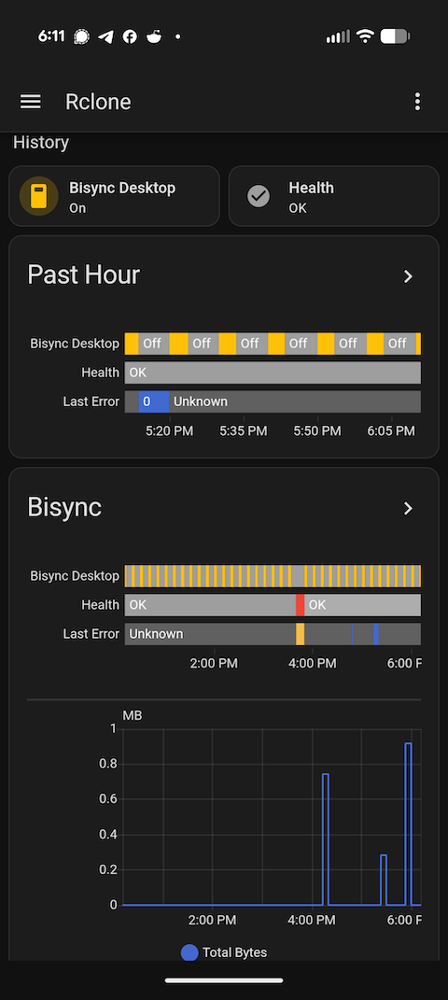
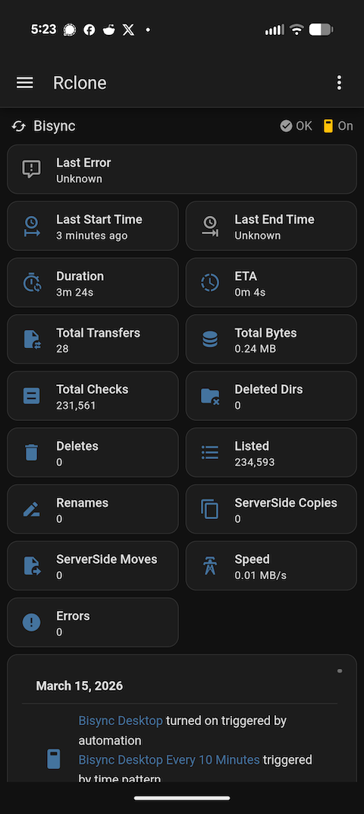
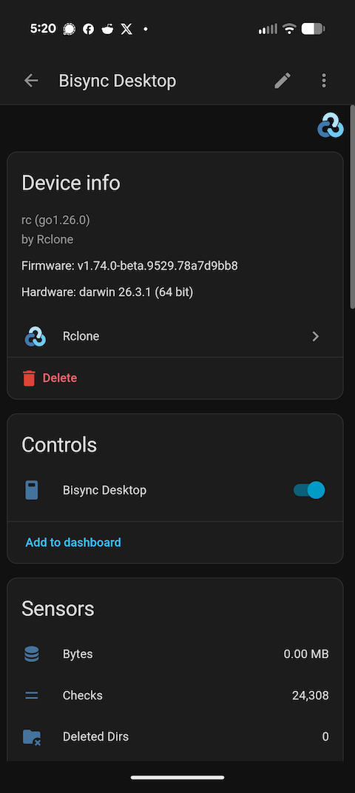
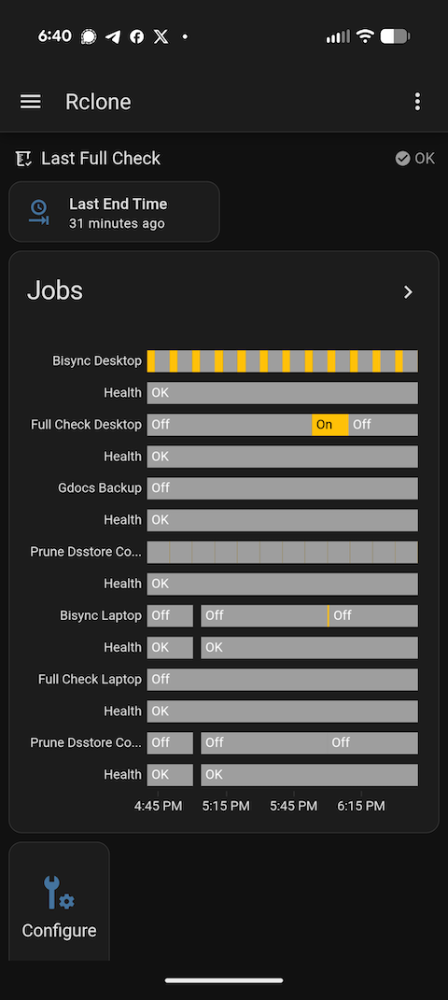
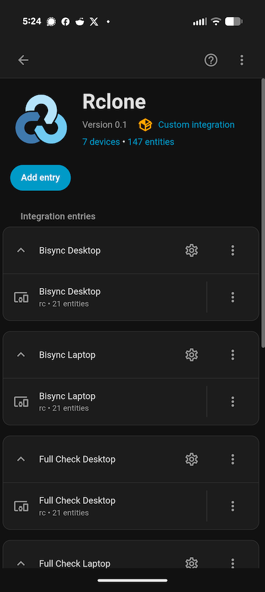
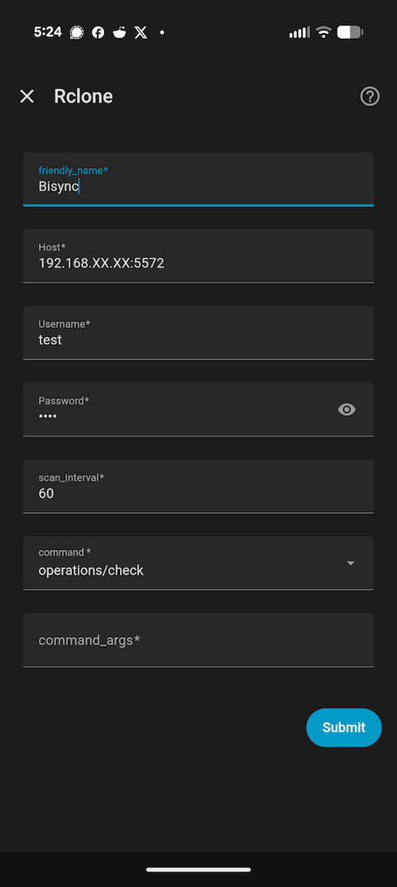
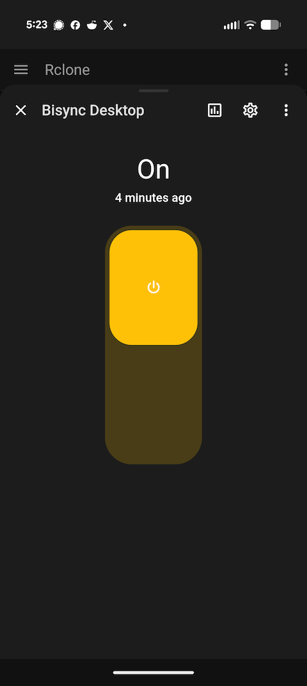
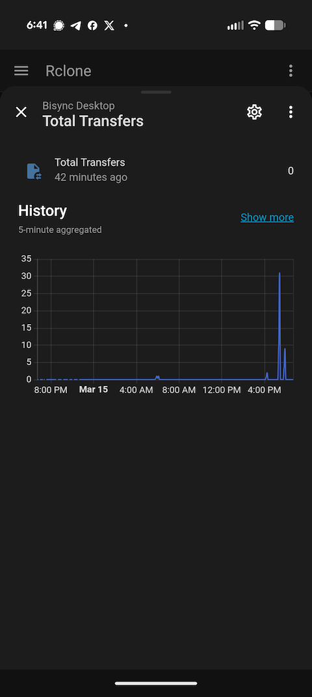

# CloneAssistant

Control and monitor your recurring [Rclone](https://rclone.org) jobs from [Home Assistant dashboards](https://www.home-assistant.io/dashboards/).

 

## Features

- Control and monitor Rclone jobs running on another device, via the [rc](https://rclone.org/rc/) API
- Start/Stop a job from a Home Assistant "switch" device
- Customizable sensors to monitor job stats and health
- Track when each job last _succeeded_, so you can alert on jobs that have been failing for hours
- Easily build custom automations and dashboards
- Fully local by default – no cloud access required

This is intended for a particular use case: you have one or more rclone commands that you want to run on a recurring schedule (for example, to [bisync](https://rclone.org/bisync/) a [local machine](https://rclone.org/local/) with an [rclone remote](https://rclone.org/overview/)), and you want to monitor the health and progress of those jobs from beautiful Home Assistant dashboards. Perhaps you also want to leverage Home Assistant's powerful [automation](https://www.home-assistant.io/docs/automation/) and [notification](https://www.home-assistant.io/integrations/notify/) features (say, to alert you if something fails, trigger an rclone job from some other event, or skip a run when a prior command is running.)

The rclone jobs you monitor do not need to be running on the same machine as Home Assistant. For example, Home Assistant can monitor rclone jobs running on multiple different LAN-connected computers. It can also run concurrent async jobs on the same machine, while managing the concurrency efficiently and tracking stats separately.

 

<details>
  <summary>More screenshots</summary>

 
 

</details>

## Quick Start

> [!TIP]
> For more detailed instructions, see [Installation](#installation) section below

1. Start [rclone](https://rclone.org/) with [remote control listening](https://rclone.org/commands/rclone_rcd/):

   ```sh
   rclone rcd -vv --rc-addr=localhost:5572 --rc-user=SOME_USERNAME --rc-pass=SOME_PASSWORD --rc-job-expire-duration=1h
   ```

2. Install [integration](https://github.com/nielash/cloneassistant):

   Copy the `custom_components/rclone` directory into your Home Assistant `config/custom_components` directory, and restart Home Assistant.

3. Click "[Add Entry](http://homeassistant.local:8123/config/integrations/integration/rclone)" button and follow setup wizard

   [](https://my.home-assistant.io/redirect/integration/?domain=rclone)

## Installation

> [!NOTE]
> The following steps assume you have [Home Assistant](https://www.home-assistant.io/installation/) and [Rclone](https://rclone.org/install/) installed on the device(s) where you want to run them.

> [!TIP]
> While running Home Assistant on [dedicated hardware](https://www.home-assistant.io/installation/) is recommended, it is not required. Rclone users looking to use Home Assistant solely as an Rclone GUI could consider running Home Assistant from a [docker container](https://www.home-assistant.io/installation/#install-home-assistant-on-linux).

### 1. Run Rclone with remote control listening

On the device that you want to control, run [rclone](https://rclone.org/) with [remote control listening](https://rclone.org/commands/rclone_rcd/) enabled:

```sh
rclone rcd -vv --rc-addr=localhost:5572 --rc-user=SOME_USERNAME --rc-pass=SOME_PASSWORD --rc-job-expire-duration=1h
```

> [!IMPORTANT]
> Authentication is required, even on `localhost`. [`--rc-user`](https://rclone.org/rc/#rc-user-value) and [`--rc-pass`](https://rclone.org/rc/#rc-pass-value) can be anything you want, as long as you use the same credentials on the server and client sides.

Rclone defaults to `http://localhost:5572` unless a different [`--rc-addr`](https://rclone.org/commands/rclone_rcd/#server-options) is specified. This is fine if you are running Home Assistant and Rclone on the same device. If you are running them on different local devices connected to the same LAN, you can use a local IP address like `--rc-addr=192.168.XX.XX:5572` (depending on your router settings). The port can be customized as needed.

> [!WARNING]
> Using a public IP address is also possible, but make sure you understand the security implications. Consider using something like [tailscale](https://tailscale.com/docs/how-to/quickstart) to mitigate risks. See also HA's docs on [remote access](https://www.home-assistant.io/docs/configuration/remote/). Only `http` is supported at this time. [`https`](https://tailscale.com/docs/how-to/set-up-https-certificates) could conceivably be supported in a future version.

Because rclone needs to be running in order for Home Assistant to reach it, consider setting up a cron job to periodically run `rclone rcd`, to ensure rclone remains accessible in the event of fatal errors or machine restarts.

For example, the following cron job:

```sh
*/5 * * * * rclone rcd -vv --rc-addr=localhost:5572 --rc-user=SOME_USERNAME --rc-pass=SOME_PASSWORD --rc-job-expire-duration=1h
```

will attempt to run the [`rclone rcd`](https://rclone.org/commands/rclone_rcd/) command every 5 minutes. If a prior rclone instance is already running on that [`--rc-addr`](https://rclone.org/commands/rclone_rcd/#server-options), the newer instance will simply exit with `address already in use`.

> [!TIP]
> Consider adjusting your computer's auto-sleep settings as necessary. If Home Assistant can't reach your computer because it is sleeping, the command will temporarily show as "unavailable" in Home Assistant. It should automatically become "available" again once it wakes up.

> [!NOTE]
> `--rc-job-expire-duration=1h` (or longer) is recommended, to ensure that the [async jobs](https://rclone.org/rc/#running-asynchronous-jobs-with-async-true) do not disappear before HomeAssistant has a chance to poll them for stats. Rclone's default (`60s`) is quite short, and Home Assistant [tends to encourage longer polling intervals](https://developers.home-assistant.io/docs/core/integration-quality-scale/rules/appropriate-polling). This integration allows the polling interval for each job to be customized during setup, and the code also attempts to be efficient about not polling jobs when we already know they're not running.

> [!NOTE]
> `-vv` just enables debug logging on the server side. Feel free to omit this if you wish.

### 2. Install the Rclone integration in Home Assistant

> [!NOTE]
> For now, this is simply a ["custom integration"](https://developers.home-assistant.io/docs/creating_component_index) rather than an official published ["core" integration](https://www.home-assistant.io/integrations/?brands=featured). (I might consider submitting it at some point, if there's enough user interest.)

> [!TIP]
> If you have [HACS](https://hacs.xyz/) installed (optional), you can install this as a ["custom repository"](https://hacs.xyz/docs/faq/custom_repositories/).

1. Locate your Home Assistant [`config/custom_components`](https://www.home-assistant.io/docs/configuration/#to-find-the-configuration-directory) directory. It may need to be created.

> [!TIP]
> There are numerous options to access this directory, including the [file editor app](https://www.home-assistant.io/common-tasks/os/#installing-and-using-the-file-editor-app), [Samba app](https://www.home-assistant.io/common-tasks/os/#installing-and-using-the-samba-app), and [SSH app](https://www.home-assistant.io/common-tasks/os/#installing-and-using-the-ssh-app).

> [!TIP]
> If the [Samba app](https://www.home-assistant.io/common-tasks/os/#installing-and-using-the-samba-app) is enabled, rclone itself can be used to copy files to it, using the [SMB backend](https://rclone.org/smb/).

2. Copy the `custom_components/rclone` directory into your Home Assistant `config/custom_components` directory, including the `rclone` folder itself.

   The following example shows how to do this using rclone, assuming you have set up an [`smb`](https://rclone.org/smb/) remote named `homeassistant:`

   ```sh
   # download repo zip from github
   rclone copyurl "https://github.com/nielash/cloneassistant/archive/refs/heads/main.zip" cloneassistant.zip

   # extract it locally
   rclone archive extract cloneassistant.zip cloneassistant_extracted

   # copy to HA config/custom_components directory
   rclone sync cloneassistant_extracted/cloneassistant-main/custom_components/rclone homeassistant:config/custom_components/rclone --exclude "userfiles/**"
   ```

3. [Restart](https://www.home-assistant.io/docs/configuration/#reloading-the-configuration-to-apply-changes) Home Assistant.

### 3. Configure the Integration

1. Navigate to Settings > Devices & services > Add integration and search "rclone", or use this shortcut:

   [](https://my.home-assistant.io/redirect/config_flow_start/?domain=rclone)

2. Follow the config wizard to configure your first rclone job. (An "entry" here corresponds to one rclone command.)

> [!NOTE]
> When you configure a command and click "Submit", Home Assistant will verify that it can connect to rclone successfully. However, it will not actually run your configured command. To run it, use the provided "switch" device in the UI, or create an [automation](https://www.home-assistant.io/getting-started/automation/) that uses it as an "action".

| Setting         | Description                                                                                                                                                                                                                                                                                                                                                                                                               | Example                                                                                          |
| --------------- | ------------------------------------------------------------------------------------------------------------------------------------------------------------------------------------------------------------------------------------------------------------------------------------------------------------------------------------------------------------------------------------------------------------------------- | ------------------------------------------------------------------------------------------------ |
| `friendly_name` | A human-friendly name to identify this rclone command. Tip: keep this short.                                                                                                                                                                                                                                                                                                                                              | `Bisync Laptop`                                                                                  |
| `Host`          | the `--rc-addr` for this job. Prefix it with `https://` if rclone serves TLS ([`--rc-cert`](https://rclone.org/commands/rclone_rcd/#tls-ssl)) or sits behind an HTTPS reverse proxy. The certificate must be one Home Assistant trusts (e.g. Let's Encrypt); self-signed certificates are not supported. Anything after the port is used as the [`--rc-baseurl`](https://rclone.org/commands/rclone_rcd/#server-options). | `192.168.12.34:5572` or `https://rclone.example.com`                                             |
| `Username`      | the `--rc-user` for this job                                                                                                                                                                                                                                                                                                                                                                                              | `nielash`                                                                                        |
| `Password`      | the `--rc-pass` for this job                                                                                                                                                                                                                                                                                                                                                                                              | `ZqOa*c!U8O^L1P&Xfi8#`                                                                           |
| `scan_interval` | number of seconds to wait between stats refreshes, while job is running. Default: `60`, Minimum: `5`. Shorter intervals will use more resources.                                                                                                                                                                                                                                                                          | `5`                                                                                              |
| `command`       | the [rc method](https://rclone.org/rc/#supported-commands) (rclone command) you wish to run.                                                                                                                                                                                                                                                                                                                              | `sync/bisync`                                                                                    |
| `command_args`  | the parameters (flags) for the command, in [JSON blob format](https://rclone.org/rc/#json-input). See [examples](#command_args-json-examples) below. Must be [valid JSON](https://www.json.fr/). Note that `_async = true` will be added automatically; it does not need to be supplied.                                                                                                                                  | `{"path1": "/some/local/path", "path2": "some_remote:path", "filtersFile": "/some/filters.txt"}` |

#### `command_args` JSON Examples

> [!TIP]
> Use a [JSON validator](https://www.json.fr/) to validate (and beautify) your JSON.

- [Bisync JSON Example](https://github.com/nielash/cloneassistant/blob/main/examples/commands/bisync_example.json)
  - Reference: <https://rclone.org/rc/#sync-bisync>
- [Sync JSON Example](https://github.com/nielash/cloneassistant/blob/main/examples/commands/sync_example.json)
  - Reference: <https://rclone.org/rc/#sync-sync>
- [Check JSON Example](https://github.com/nielash/cloneassistant/blob/main/examples/commands/check_example.json)
  - Reference: <https://rclone.org/rc/#operations-check>
- [Delete JSON Example](https://github.com/nielash/cloneassistant/blob/main/examples/commands/delete_example.json)
  - Reference: <https://rclone.org/rc/#operations-delete>

3. Enter a "Device" name (usually the suggested default will be fine) and complete setup.

Upon completing setup, you will see the "device" and "entities" created for this command.

> [!NOTE]
> If the terms "device" and "entity" seem odd in this context, it is because Home Assistant is intended for physical smart home / IOT devices. An rclone command doesn't fit perfectly onto this concept, but you can think of it like a virtual light switch "device". When the switch is "on", the job is running; when it's "off", the job is not running. It has "sensor" entities that each correspond to one stats metric (bytes transferred, number of checks, start time, etc.) Because you may have more than one rclone command configured, a ["device"](https://www.home-assistant.io/getting-started/concepts-terminology/#devices) is how we logically group the "entities" for a given command to keep them together, and keep them separate from the ["entities"](https://www.home-assistant.io/getting-started/concepts-terminology/#entities) of another command.

You can verify that your command is working by switching it "on" in the UI.

> [!TIP]
> The command's output (if any), can be viewed in the "Details" attributes of the "switch" entity. (Three-dots menu > "Details")

### 4. (Optional) Schedule the command to run

Home Assistant's powerful automation features make it easy to trigger your command based on schedules, events, the state of other entities, and many other things. Here's a simple example showing a command that runs every 10 minutes:

```yaml
alias: Bisync Desktop Every 10 Minutes
description: ""
triggers:
  - trigger: time_pattern
    minutes: /10
conditions: []
actions:
  - type: turn_on
    device_id: some_device_id
    entity_id: some_entity_id
    domain: switch
mode: single
```

The easiest way to set these up is through the visual editor (Settings > Automations & scenes > Create automation). Your "action" will want to turn "on" the switch "device" corresponding to this command.

### 5. (Optional) Alert when a job stops succeeding

Every job has a **Last Success Time** sensor. Unlike **Last End Time**, it is only
updated when a run finishes without an error -- a failed run leaves it alone. That makes
`now() - last_success_time` a direct answer to "how long has this job been broken?", which
is the thing you actually want to alert on.

The sensor is **disabled by default**. To use it, open the job's device (Settings > Devices
& services > Rclone), find **Last Success Time** under the hidden or disabled entities, and
enable it. Home Assistant reloads the integration, and the sensor reads `unknown` until the
job's next clean run.

This matters because rclone's `rcd` forgets a job once `--rc-job-expire-duration` passes,
so nothing on the rclone side remembers when the job last worked. The integration stores
the value and restores it when Home Assistant restarts.

It also stores the job it is waiting on, so a run that is still going when Home Assistant
restarts (or the integration reloads) is picked up again afterward. If rclone can no
longer report on it -- `rcd` restarted too, or the job finished and expired before Home
Assistant was back -- the run ends as a failure: the switch turns off, **Health** reports
a problem, and **Last Error** says what happened. Keep `--rc-job-expire-duration` longer
than a Home Assistant restart (the recommended `1h` is plenty), so a run that finishes in
the meantime is still reported as it actually went.

Here is an automation that notifies you when a job has not succeeded in 24 hours. Adjust
the threshold per job -- a bisync that runs every 10 minutes deserves a much tighter one
than a nightly backup:

```yaml
alias: Alert if Bisync Desktop has not succeeded in 24 hours
description: ""
triggers:
  - trigger: template
    value_template: >-
      {{ now() - states('sensor.bisync_desktop_last_success_time') | as_datetime
      > timedelta(hours = 24) }}
    # Keep firing while it stays broken, rather than only on the crossing.
    for:
      minutes: 10
conditions: []
actions:
  - action: notify.persistent_notification
    data:
      title: Rclone job failing
      message: >-
        Bisync Desktop has not completed successfully since
        {{ states('sensor.bisync_desktop_last_success_time') | as_datetime
        | relative_time }} ago.
mode: single
```

> [!NOTE]
> `Last Success Time` is `unknown` until the first run finishes cleanly, and
> `as_datetime` on `unknown` yields `none`. Add a
> `{{ has_value('sensor.bisync_desktop_last_success_time') and ... }}` guard if you want a
> brand-new install to stay quiet rather than error in the template.

By default, the sensor agrees with rclone about what "success" means: the run counted as
a success if rclone reported no error.

A run can report no error and still leave errors in its stats. The clearest case is
`operations/check`, the default command: it counts every error it runs into, but only
returns one if it found actual _differences_. So a subdirectory it could not list leaves
the run "successful" with a nonzero **Errors** sensor -- everything it managed to compare
matched, but it did not get to see everything. If you would rather treat that as a
failure, enable **Count runs with errors as failed** in the integration's options (see
[Editing your Configuration](#7-editing-your-configuration)).

> [!NOTE]
> This is not about retries. A file that fails and then succeeds on a retry is not counted
> as an error at all, and a file that stays unreadable is counted _and_ reported as the
> job's error, so it already fails without this option. Note also that rclone's high-level
> `--retries` does not apply to jobs started over the rc API -- only `--low-level-retries`
> does.

The **Health** binary sensor is deliberately unaffected by that option, so existing
automations watching it keep behaving exactly as before.

**Health** reads `unknown` after Home Assistant starts, until the integration has polled a
run: it reports what rclone says about a run, and until then there is nothing to report. (It
used to read OK at startup, which claimed a verdict nobody had checked.) While a run is in
flight it reads OK unless rclone has already reported an error, as before. If a run was
still going when Home Assistant stopped, it is picked up again right away.

### 6. (Optional) Set up a Dashboard

While it's easy enough to monitor entities from the default "device" page, you may want to set up a "Dashboard" to emphasize the jobs and metrics that are most important to you, and customize how they are displayed. Designing dashboards is a huge topic and beyond the scope of this tutorial, but for convenience, an [example template](https://github.com/nielash/cloneassistant/blob/main/examples/dashboards/rclone_dashboard.yaml) is provided. You will need to replace the entities with your own.

### 7. Editing your Configuration

The settings you configured in the previous steps can be easily re-configured as necessary later, without having to delete the device and start over.

1. Navigate to the [integration page](https://my.home-assistant.io/redirect/integration/?domain=rclone)

   [](https://my.home-assistant.io/redirect/integration/?domain=rclone)

2. To edit the `scan_interval`, `command`, `command_args`, or `count_errors_as_failure`, click the "gear" icon corresponding to the entry for the command.

3. To edit the `friendly_name`, `Host`, `Username`, or `Password`, click the three-dots menu corresponding to the entry for the command, and select "Reconfigure".

You can also change the names, icons, and units of individual entities, should you wish.

## Status

This integration is in beta. Future versions may have substantial breaking changes. User feedback is always welcome, and is especially helpful in this early development period.

## License

This is free software under the terms of the MIT license.

## Contributing

Please feel free to use Github "Issues" to submit bug reports and feature requests.

Please also feel free to submit "Pull requests" (which are most welcome!)

And if you build some cool custom dashboards/panels/cards/etc. and feel like sharing in "Discussions", I'd love to see them!

## Credits

Big thanks to [@ncw](https://github.com/ncw) for the ingenious tool that is [rclone](https://github.com/rclone/rclone).

And another big thanks to [@msp1974](https://github.com/msp1974), whose [HAIntegrationExamples](https://github.com/msp1974/HAIntegrationExamples) repo was hugely helpful to me in creating this integration.
